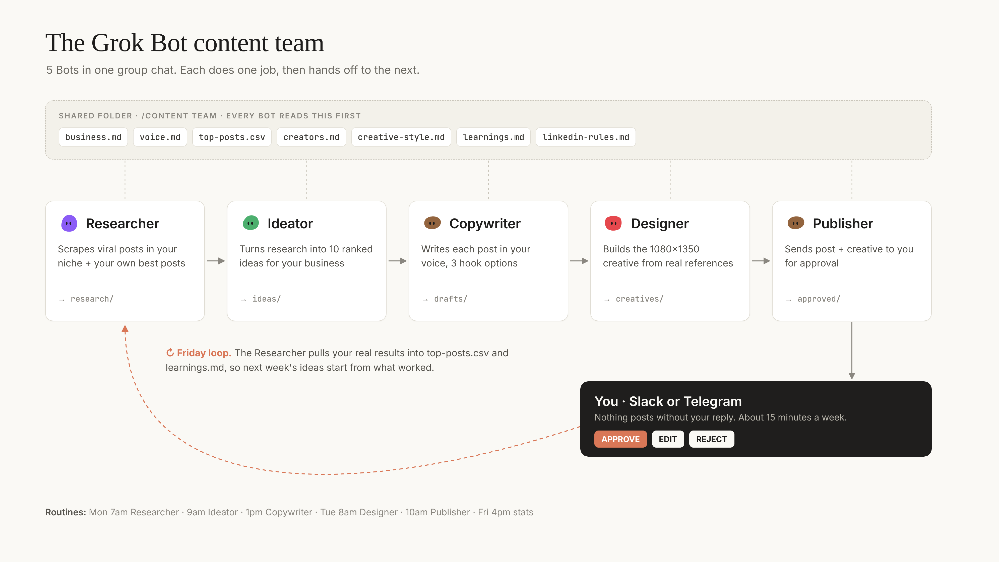
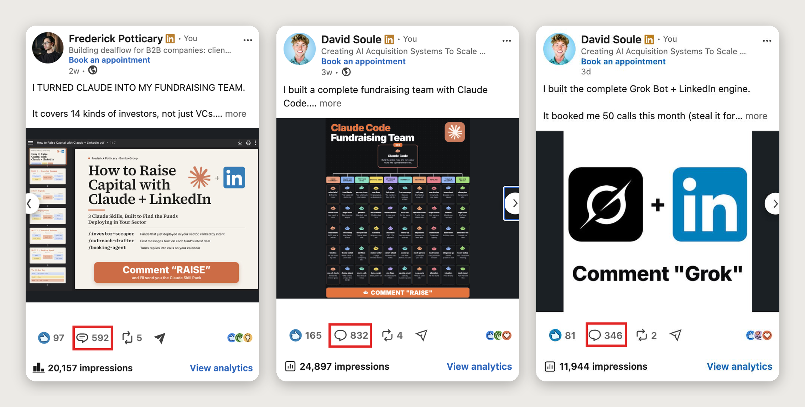
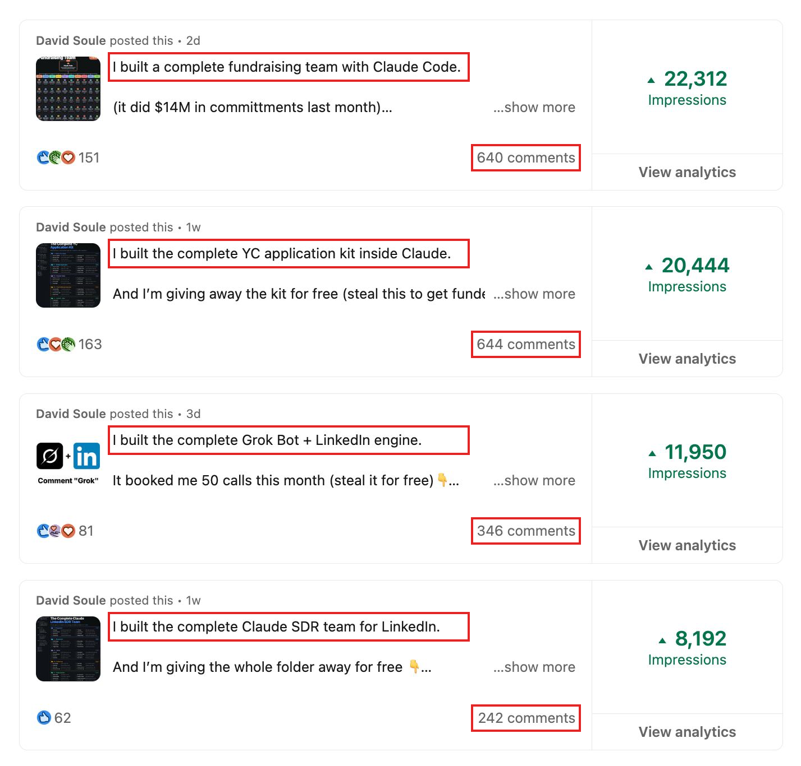

# Grok LinkedIn Content Team

**5 Grok Bots that research, write, design and queue your LinkedIn posts. You just approve them.**



Built by Frederick Potticary at [Bambo](https://bamboai.com). Free to use.

---

## What this is

A ready-to-install content team for [Grok Bot](https://x.ai). Five Bots, one job each:

| Bot | Job |
| --- | --- |
| 1. Researcher | Finds the LinkedIn posts going viral in your niche, plus your own best posts |
| 2. Ideator | Turns them into 10 ranked post ideas for your business |
| 3. Copywriter | Writes each post in your voice, with 3 hook options |
| 4. Designer | Makes the 1080x1350 creative |
| 5. Publisher | Sends it to you on Slack or Telegram. Nothing posts until you reply APPROVE |

Every Friday it pulls your results, learns what worked, and next week's ideas get better.

**Your time: about 15 minutes a week.**

---

## Why it works

This is the same process behind our team's most-commented LinkedIn posts:



Every one follows the same pattern. The Bots run it every week:



---

## Install in 3 steps

### 1. Download this repo

Click the green **Code** button above, then **Download ZIP**.

### 2. Give it to Grok

Open Grok Bot, upload the ZIP, and paste the prompt from [`INSTALL-PROMPT.md`](INSTALL-PROMPT.md).

### 3. Answer Grok's questions

Grok interviews you about your business, your best posts and your style. Then it:

- Creates your **Content Team** folder in Google Drive
- Fills in your context files
- Creates the 5 Bots
- Connects Slack or Telegram for approvals
- Runs a 2-post test for you to check

Once you're happy with the test, say **"Turn on the routines."** That's it.

---

## What you need

| Tool | Why |
| --- | --- |
| Grok Bot | Runs the 5 Bots. In beta, comes with SuperGrok Heavy or Cursor Ultra. Check current plans at x.ai |
| Google Drive | Holds the shared Content Team folder |
| Apify (free tier works to start) | Scrapes LinkedIn posts. Use a "LinkedIn Profile Posts Scraper (No Cookies)" actor |
| Slack or Telegram | Where your approvals land |
| A scheduler (optional) | Buffer, Taplio or similar, so posts are scheduled safely |

---

## What's in this repo

```
INSTALL-PROMPT.md        ← paste this into Grok
bots/                    ← the 5 Bot instructions
  1-researcher.md
  2-ideator.md
  3-copywriter.md
  4-designer.md
  5-publisher.md
context/                 ← templates Grok fills in with your info
  business.md
  voice.md
  top-posts.csv
  creators.md
  creative-style.md
  learnings.md
rules/
  linkedin-content-rules.md   ← how LinkedIn content works, every Bot reads it
```

---

## The weekly rhythm

| Day | What happens | Your time |
| --- | --- | --- |
| Monday | Research, ideas and drafts | 0 min |
| Tuesday | Creatives and approvals land in Slack or Telegram | 15 min |
| Wed to Fri | Approved posts go out on schedule | 0 min |
| Friday | Stats pulled, learnings updated | 0 min |

---

## The rules

1. Nothing posts without your **APPROVE**
2. Real numbers only. If it's not in `business.md`, it doesn't go in a post
3. Your best posts count more than anyone else's
4. Comment keyword goes on the creative, never in the post copy
5. Each Bot does one job. Don't add more, because usage limits run out fast
6. Never let a Bot log into your LinkedIn. Use a scheduler

---

## Want it done for you?

We build and run LinkedIn content and outbound for B2B companies. [bamboai.com](https://bamboai.com)

---

*Grok Bot is in beta. Features, plans and limits can change. Scraping and automation should follow each platform's terms. Results vary.*
